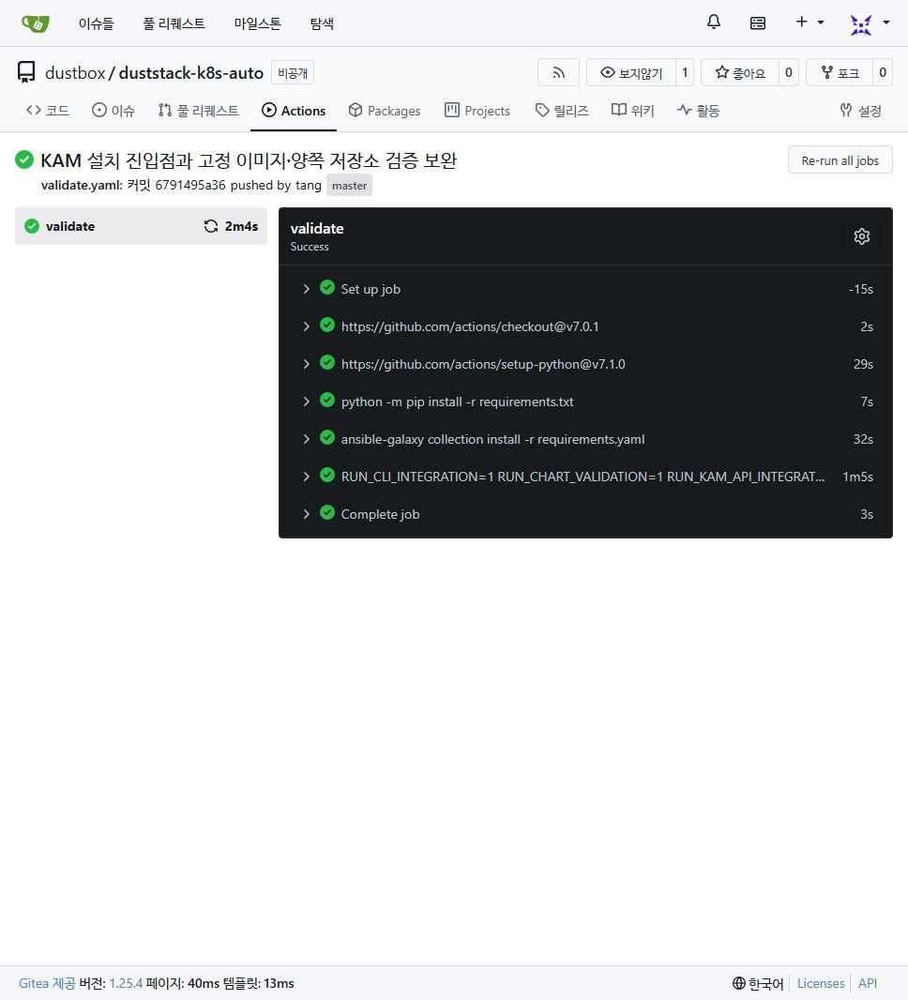

# HA·KAM·Git 원격 운영

## 이중 LB와 control plane

새 HA 환경은 별도 LB 2대와 홀수 control plane 3대 이상으로 구성합니다.
기존 `haproxy`, `keepalived` 모드는 유지하며 조합 모드는 명시적으로 선택합니다.
기존 클러스터의 API DNS·포트·CIDR 변경은 계속 거부합니다. LB 추가 자체가 기존
endpoint를 변경하는 마이그레이션을 대신하지 않습니다.

비공개 인벤토리에 다음을 반영하세요.

```yaml
# 공통 설정: 생성기의 호스트 YAML merge 또는 별도 -e @vars.yaml로 적용
k8s_proxy_mode_enable: true
k8s_proxy_mode: haproxy_keepalived
k8s_api_domain: api.example.com  # 두 LB의 VIP를 가리키는 DNS
k8s_vip_address: 10.10.10.250  # VM 고정 IP와 다른 예약된 미사용 주소
k8s_vrrp_router_id: 51        # 같은 네트워크의 다른 VRRP 그룹과 구분
lb:
  hosts:
    lb1:
      nodename: lb1.example.com
      k8s_ip4: 10.10.10.251/24
      k8s_interface: eth1
      keepalived_node: master
      keepalived_pri: 110
    lb2:
      nodename: lb2.example.com
      k8s_ip4: 10.10.10.252/24
      k8s_interface: eth1
      keepalived_node: backup
      keepalived_pri: 100
```

위 조각을 기존 인벤토리에 병합하고 `lb`를 `kubernetes.children`에 포함합니다.
같은 디렉터리의 `group_vars`는 인벤토리에 직접 쓴 그룹 변수보다 우선합니다.
직접 작성한 인벤토리는 호스트 변수나 비공개 extra vars 파일로 설정을 확정하고,
`ansible-inventory -i 인벤토리 --host 호스트이름`으로 실제 적용 값을 대조하세요.
`configure` 생성 결과는 공통 블록을 호스트 YAML merge로 공유해 이 충돌을 방지합니다.
두 LB는 control plane과 분리합니다. Keepalived는 unicast peer와 로컬 HAProxy
검사로 VIP를 전환하며, 검사 실패 시 FAULT 처리합니다. HAProxy는 TLS passthrough로
API 서버에 연결합니다. 신규 bootstrap 동안 TCP 검사 후 클러스터 공개 CA를 공급해
CA 검증을 사용하는 `/readyz` 검사로 전환하며, 재실행 때 TCP 검사로 되돌리지 않습니다.
공개 CA만 LB로 복사하고 관리자 개인키는 복사하지 않습니다.
API의 비인증 health endpoint가 금지된 환경은 별도의 최소 권한 probe 인증 설계가
필요합니다. `--tags k8s-haproxy`는 최초 설치를 대신하지 않습니다.

로컬 상태 검사는 `127.0.0.1:8404/health`만 사용합니다. HAProxy가 중지되면 연결이
실패하며, SELinux에서 실행이 거부되는 `systemctl`을 검사 스크립트에서 호출하지 않습니다.
SELinux enforcing 호스트에서는 이 TCP 포트만 `http_port_t`로 등록합니다.
`keepalived_connect_any`나 unconfined 스크립트 전환은 사용하지 않습니다.
적용 후 Keepalived journal과 AVC를 확인하세요. 배포판의
[Keepalived 정책](https://github.com/fedora-selinux/selinux-policy/blob/rawhide/policy/modules/contrib/keepalived.te)은
HTTP 포트 연결과 전체 포트 연결을 구분합니다.

추가 control plane용 인증서 업로드는 첫 노드의
`/etc/kubernetes/kubeadm-init.yaml`을 명시해 수행합니다. 다중 NIC 환경에서
기본 API 주소 추론에 의존하지 않습니다. 기존 클러스터에 이 파일이 없으면
현재 클러스터와 일치하는 검토된 초기화 설정을 복원한 뒤 재시도하세요.
가입 토큰·인증서 암호화 키는 로그에 출력하지 않으며 가입 설정 파일은 성공·실패
모두 정리합니다. 기존 클러스터의 주소·CIDR를 새 기본값으로 덮어쓰면 안 됩니다.

Calico 재적용은 기존 pool의 CIDR·blockSize·VXLAN·NAT·nodeSelector·BGP 정책이
현재 인벤토리와 일치하는지 먼저 검사합니다. operator가 채운 `allowedUses`,
`assignmentMode`, pool 이름 등의 추가 필드는 보존해 SSA 충돌을 방지합니다.
정책이 다르면 중단하며 `--force-conflicts`로 덮어쓰지 않습니다.
기존 operator 이미지가 고정 매니페스트와 같으면 CRD·operator 묶음을 다시 적용하지
않습니다. operator가 관리하는 admission mutation 정책을 보존하기 위한 동작입니다.
이미지가 다르면 자동 교체하지 않습니다. CRD 복구나 Calico 업그레이드는 별도 절차로
진행하세요.

같은 L2의 VIP 이동·unicast VRRP·TCP 6443을 네트워크에서 허용해야 합니다.
OpenStack은 VIP의 allowed-address-pairs/가상 포트 정책을 먼저 확인하세요.
control plane에 LB를 함께 배치하는 구성은 포트 충돌 때문에 이 모드에서 거부합니다.

OpenStack 포털에 포트의 allowed-address-pairs 메뉴가 없으면 관리자에게 해당 두 LB의
전용망 포트만 설정하도록 요청합니다. 아래는 **관리자 실행 예시**이며 실증 통과 기록이 아닙니다.
포트의 network/device_id/fixed_ips를 먼저 대조하고, DHCP/IPAM에서 예약한 VIP 하나만
각 포트에 추가하세요. 기존 허용 주소는 보존하고 전체 포트 보안을 해제하지 않습니다.

```bash
openstack port list --network PRIVATE_NETWORK_ID --server LB_SERVER_ID --long
openstack port show VERIFIED_LB_PORT_ID -c network_id -c device_id -c fixed_ips -c allowed_address_pairs
openstack port set --allowed-address ip-address=RESERVED_VIP/32 VERIFIED_LB_PORT_ID
openstack port show VERIFIED_LB_PORT_ID -c allowed_address_pairs -c port_security_enabled
```

`--allowed-address`는 기존 목록에 추가하며 `--no-allowed-address`를 함께 쓰면 덮어씁니다.
자세한 동작은 [OpenStackClient 공식 포트 문서](https://docs.openstack.org/python-openstackclient/latest/cli/command-objects/network/v2/index.html#port-set)를 참고하세요.

실증 완료 조건: LB 프로세스/VM 장애 시 VIP 이동, API backend 장애 제외,
etcd 1개 장애 시 정족수 유지, watch 재연결, VIP 중복 보유 방지, 재부팅·재실행 확인.
이번 변경의 로컬 회귀·렌더링은 해당 실제 HA 장애 실증을 대신하지 않습니다.

전용 랩의 control plane에서 아래 도구를 실행할 수 있습니다. `--lb`는 실제 LB의 SSH
주소로 바꾸고, 해당 랩에서 확인한 host key 파일과 제한된 임시 키를 공급하세요.
선택한 kubeconfig API 주소가 VIP로 해석되는지 검사한 후 활성 LB의 HAProxy만 중지합니다.
VIP 단일 소유권·이동 시간과 `/readyz` 응답을 기록하고 `finally`에서 HAProxy를 복구합니다.
운영 환경에서는 실행하지 마세요. 이 검사는 VM 전원 장애·etcd 장애·watch 재연결 검사를
대신하지 않습니다.

```bash
python scripts/test_live_ha.py --kubeconfig /etc/kubernetes/admin.conf \
  --vip 10.10.10.250 --lb root@10.10.10.251 --lb root@10.10.10.252 \
  --interface eth1 --identity-file /path/to/lab-key \
  --known-hosts /path/to/lab-known-hosts --confirm-disposable-lab
```

## Namespace KAM

`addons/kam/`은 KAM의 논리 사용자·Group·ServiceAccount 권한 관리 개념을
CRD와 Python controller, `kubectl-kam` 플러그인으로 구현한 선택 설치 애드온입니다.
원래 [KAM Go CLI](https://github.com/tangt64/KAM)는 수정하지 않았습니다.
API group은 `access.kam.dustbox.kr`, kind는 `KamAccessGrant`, 약칭은 `kag`입니다.
CRD 설치는 cluster 관리자, namespace별 controller 설치와 Grant 작성은 해당 권한을
명시적으로 위임받은 관리자가 수행합니다. 일반 `edit` 역할에 CR 쓰기 권한을 자동
추가하지 않습니다. 이 API는 로그인 계정·인증서·Group 멤버십·토큰을 발급하지 않습니다.

Python 3.12+와 PyYAML, kubectl을 준비한 관리자 환경에서 실행합니다.
기본 이미지는 실제 비루트·읽기 전용 실행을 확인한 공식 Python 3.12.16
slim-bookworm Linux amd64 이미지를 digest로 고정합니다. 다른 아키텍처·사내 미러는
`--image 저장소:버전@sha256:실제64자리해시`로 검증한 이미지를 공급하세요.

```bash
python addons/kam/render.py --namespace dev > /tmp/kam-dev.yaml
kubectl apply --server-side --dry-run=server -f /tmp/kam-dev.yaml
kubectl apply --server-side -f /tmp/kam-dev.yaml
kubectl wait --for=condition=Established crd/kamaccessgrants.access.kam.dustbox.kr
kubectl -n kam-system rollout status deployment
install -m 0755 addons/kam/kubectl-kam "$HOME/.local/bin/kubectl-kam"
export PATH="$HOME/.local/bin:$PATH"
kubectl kam grant alice@example.com -n dev --profile view --dry-run server
kubectl kam grant alice@example.com -n dev --profile view
kubectl get kamaccessgrants -n dev
kubectl wait --for=condition=Ready kag --all -n dev --timeout=120s
kubectl kam revoke alice@example.com -n dev --profile view
```

namespace `dev`와 관리자 전용 `kam-system`은 설치 전에 있어야 합니다.
기존 인벤토리의 control plane에서 설치할 때는
`bash setup-k8s.sh kam -i inventory/local-lab/hosts.yaml -e kam_namespace=dev -e kam_confirm_admin=true`
진입점도 사용할 수 있습니다. 이 명령은 기본 클러스터 설치와 분리돼 있으며
native API dry-run, CRD Established, 해당 controller rollout을 검사합니다.
`kam-system`에는 일반 사용자의 edit/admin·Pod 생성·ServiceAccount 사용 권한을
부여하지 마세요. controller/소스 ConfigMap/ServiceAccount/Lease는 이 관리 namespace에
배치하고 대상 namespace의 RoleBinding만 변경합니다. CRD Established 이전 CR 생성은 재시도하세요.
플러그인은 kubectl의 kubeconfig/context/KUBECONFIG 처리를 사용하며 관리자 자격을
내장하지 않습니다. `get`의 선택적 이름은 CR 이름, grant/revoke의 이름은 subject입니다.
만료는 `--expires-at 2026-12-01T00:00:00Z`처럼 timezone 포함 RFC3339를 사용합니다.
프로필 변경은 기존 Grant 회수 후 다른 프로필로 부여하세요. 서로 다른 프로필의 Grant는
동시에 존재할 수 있고 RBAC 권한은 합산됩니다.

controller는 대상 namespace마다 2개 replica와 resourceVersion 기반 Lease 경쟁을 사용하며,
서로 다른 호스트에 배치하도록 제한하고 PDB `minAvailable: 1`을 제공합니다.
두 replica를 실행할 스케줄 가능한 노드 2대가 필요합니다.
기본 bind 허용 대상은 `view`뿐입니다. `--profile view --profile edit`로 렌더링하면
해당 프로필과 bind 권한이 함께 확장되므로 관리자 정책 검토 후 설치하세요.
controller ServiceAccount에는 Secrets 읽기·ServiceAccount 변경·ClusterRoleBinding
관리·escalate 권한을 주지 않습니다. 기존 ServiceAccount를 참조할 수 있으나 생성·삭제는
관리자가 native Kubernetes API로 수행합니다.

Binding 이름은 CR UID에서 생성하고, 기존 Binding을 자동 인수하지 않습니다.
CR 삭제는 ownerReference 기반 native garbage collection으로 Binding을 회수합니다.
CRD 자체 삭제는 모든 Grant와 연결된 Binding을 제거할 수 있으므로 일반 종료 방법으로
사용하지 마세요. controller 중단 시 기존 Binding은 유지되고 만료 회수는 지연됩니다.
만료 처리는 10초 주기이며 즉각적인 인증 차단을 보장하지 않습니다. 다른 Binding으로
부여된 권한은 KAM Grant 회수 후에도 유지될 수 있습니다.
`roleRef` 변경은 삭제·생성이므로 짧은 권한 공백이 생길 수 있습니다.
controller 로그·Ready=False·Lease 갱신과 만료 지연을 운영 모니터링에 연결하세요.
controller 이미지/ConfigMap 변경은 Deployment rollout으로 재시작하고 허용 프로필을
축소하기 전 기존 해당 Grant를 회수하세요.

실제 클러스터 실증은 관리자 전용 namespace에서 적용/중복 적용/만료/회수와 외부 Binding·SA
보존, 허용하지 않은 프로필의 Ready=False, controller 장애·Lease 인수 및
`kubectl auth can-i --as=...` 권한을 확인해야 합니다. 단위 회귀는 API 상태를 모사합니다.
별도 `tests/run_kam_api_integration.py`는 loopback의 실제 API 서버·etcd에서 CRD/CEL,
플러그인/KUBECONFIG, ServiceAccount의 namespace bind, 상태 갱신, 중복 적용,
Lease 경쟁, 실제 권한 부여·상승 거부·만료 회수를 검사합니다. kubelet·controller-manager는
실행하지 않으므로 Pod scheduling·native garbage collection·다중 VM 장애 전환은
이 통합 테스트 범위에 포함하지 않습니다.

전용 랩에 controller를 설치한 뒤 아래 명령으로 실제 두 노드 배치, 리더 Pod 삭제 후
Lease 인수, namespace 권한·상승 거부, CR 삭제의 native GC와 만료 회수를 검사합니다.
이 명령은 테스트 Grant를 생성하고 controller 리더 Pod 하나를 삭제하므로 운영 환경에서
실행하지 마세요. 기존 사용자와 겹치지 않는 임의 subject를 사용하고 결과는 JSON으로 남깁니다.
Lease holder는 Pod 이름과 프로세스별 UUID를 포함하므로 장애 대상과 인수를 대조할 수 있습니다.

```bash
python scripts/test_live_kam.py --kubeconfig /etc/kubernetes/admin.conf \
  --namespace kam-e2e --confirm-disposable-lab
```

```bash
RUN_KAM_API_INTEGRATION=1 RUN_CHART_VALIDATION=1 bash scripts/validate.sh
# Podman에 공식 haproxy:3.2 이미지를 미리 받은 경우 실제 설정 파서 검사
python tests/run_ha_config.py
```

2026-11-01 로컬에서 회귀 64개, 공식 차트 4개, 실제 KAM API 통합 검사가 통과했습니다.
HAProxy 3.2.26의 bootstrap/readiness 설정 파서도 통과했습니다. 사용한 HAProxy 이미지
ID는 `29d2ff67f15897d9b79939b3303743c3543eb391702e3aa0e0ac1a3caa036756`입니다.
API 도구는 공식 envtest v1.37.0이며, SHA-512를 업스트림 배포 파일과 대조하고 고정
SHA-256으로 캐시 다운로드·실행을 검증합니다. 실행 바이너리·차트·인증키는 Git에서 제외합니다.

후속 수정의 회귀는 70개로 확대했습니다. 전용 VM의 실제 클러스터 설치와 HA VIP
이동·KAM 두 노드 배치·리더 인수·CR 삭제/만료 회수도 통과했습니다.
[실증 결과와 실제 화면](HA-KAM-LIVE.md)에 API 실패 표본·소스 해시·미검증 범위를 기록했습니다.

## GitHub와 Gitea 동시 운영

같은 Git 저장소에 원격 두 개를 둘 수 있습니다. GitHub `origin`을 기준으로 유지하고
Gitea URL을 확인한 뒤 추가합니다. `.github/workflows/validate.yaml`과
`.gitea/workflows/validate.yaml`은 같은 `scripts/validate.sh`를 실행합니다.

```bash
git remote add gitea https://GITEA_HOST/OWNER/duststack-k8s-auto.git
bash scripts/push-remotes.sh master
```

이 스크립트는 두 원격의 존재를 먼저 확인하고 해당 브랜치만 순서대로 push합니다.
force/mirror push와 원격 이력 덮어쓰기는 하지 않습니다. 두 서버 간 트랜잭션은 없으므로
한쪽 실패 시 성공한 쪽은 유지되며 충돌·인증을 해결한 후 재실행해야 합니다.
한쪽을 병합 기준으로 정하고 다른 쪽에는 직접 병합하지 않는 운영을 권합니다.
대안은 Gitea push mirror이며 인증 토큰·동기화 주기와 실패 알림을 별도 설정해야 합니다.
Issue·PR·Actions 결과·Secret·브랜치 보호 설정은 Git push로 복제되지 않습니다.

Gitea Actions와 runner는 별도로 활성화하고 Python 3.12 및 Node를 지원하는
`ubuntu-latest` runner 이미지를 준비하세요. Gitea workflow는 GitHub action URL을
명시합니다. 인터넷 차단 환경은 action·Python·Ansible·차트 미러가 추가로 필요합니다.
두 서비스의 토큰·runner·Secret은 분리하고 외부 PR에 쓰기 자격을 제공하지 마세요.
Gitea 대상은 `https://git.vlab.dustbox.kr/dustbox/duststack-k8s-auto`이며 비공개
저장소를 생성했습니다. HTTPS Git 인증은 자격 증명 관리자를 사용합니다.
SSH 접속은 사용하지 않습니다. 두 원격의 최종 commit SHA를 대조해야 하며,
Gitea Actions는 별도의 runner가 온라인인 경우에만 실행됩니다. 비밀번호·토큰을
인벤토리나 저장소에 기록하지 마세요.

커밋 `6791495`는 두 원격에 반영됐으며
[GitHub Actions](https://github.com/tangt64/duststack-k8s-auto/actions/runs/41271908122)와
[Gitea Actions 재실행](https://git.vlab.dustbox.kr/dustbox/duststack-k8s-auto/actions/runs/2)이
모두 통과했습니다. Gitea에서는 저장소 전용 공식 runner 5.2.0을 rootless Podman으로
실행했습니다. WSL DNS 오류의 원인·제한과 재시작 방법은 [runner 운영 안내](GITEA-RUNNER.md)를
참고하세요. 이 CI 결과는 실제 다중 VM의 VIP 장애 전환이나 Pod 배치를 증명하지 않습니다.



[Gitea 호환성](https://docs.gitea.com/usage/actions/comparison/) ·
[Kubernetes CRD](https://kubernetes.io/docs/concepts/extend-kubernetes/api-extension/custom-resources/)
