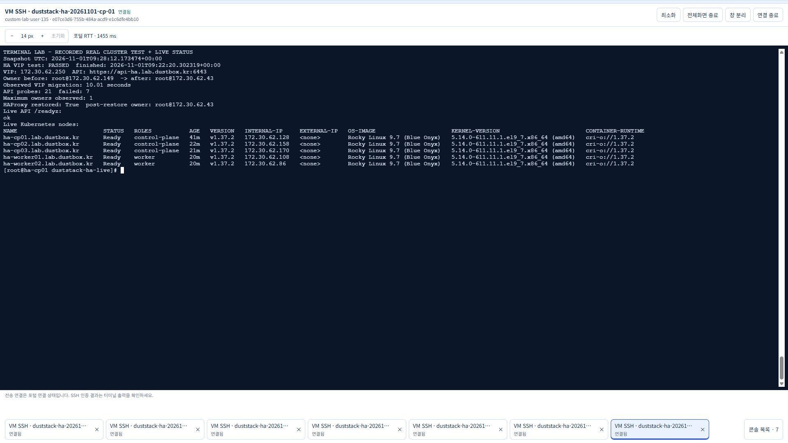
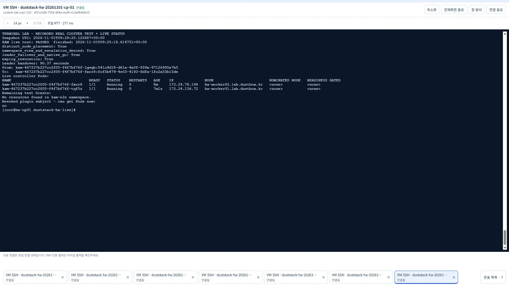

# 전용 랩 HA·KAM 실제 실증

2026-11-01 18:25 KST에 전용 랩 `duststack-ha-20261101`의 HA·KAM 검증이
모두 통과했습니다. 실제 VM에서 설치·장애 주입·권한 회수를 수행한 결과입니다.
[JSON 원문과 해시](validation/README.md), [구성·설치 안내](HA-KAM-GIT.md)를 함께 보세요.

## 실제 구성

| 항목 | 확인한 구성 |
| --- | --- |
| VM | control plane 3대, worker 2대, 별도 LB 2대 |
| 자원 | 총 14 vCPU·24 GiB RAM·OS 디스크 240 GiB |
| Kubernetes / CRI-O | 1.37.2 / 1.37.2, Kubernetes 노드 5대 모두 Ready |
| CNI | Calico 3.33.0, VXLAN, kubelet NodeInternalIP로 주소 선택 |
| 전용망 / VIP | 172.30.62.0/24 / 172.30.62.250 |
| Pod / Service CIDR | 172.24.0.0/16 / 172.25.0.0/16 |
| LB 패키지 | HAProxy 2.8.14, Keepalived 2.2.8 |
| KAM | kam-system에 controller 2개, 권한 대상 namespace는 kam-e2e |

관리·다운로드는 기존 `net-infra` NIC를 사용하고, 노드 InternalIP·Calico transport·
VRRP는 전용망을 사용했습니다. 5개 노드의 Calico IPv4 annotation과 Kubernetes
InternalIP가 모두 일치함을 검사했습니다. control plane의 전용 NIC는 `ens7`,
worker의 전용 NIC는 `ens3`이므로 공통 NIC 이름을 가정하지 않았습니다.

포털의 공유망 서브넷 조회 오류와 VIP 설정 메뉴 부재는 승인된 관리 프로필·SDK로
이번 랩의 포트만 설정해 해결했습니다. 기존 앱·다른 랩·공유 서브넷은 변경하지 않았습니다.
VIP는 DHCP 범위에서 제외하고 두 LB 전용 포트에만 `/32` allowed-address-pairs를
추가했습니다. 포트 보안은 유지했습니다. 운영 호스트 Python 3.9에 맞는 공식 SDK
4.5.0을 사용자 캐시에 격리 설치했으며, 플레이북 controller의 Python 3.12와 구분합니다.

이번 HA 랩에는 CSI를 설치하지 않았습니다. 이전 Cilium·NFS·RBD 실증과 CPU·키 호환성
경고는 [기존 기록](validation/README.md)에 별도로 보존합니다.

## HA 결과

활성 LB1(`172.30.62.149`)의 HAProxy를 중지하고 VIP 소유와 API `/readyz`를
반복 관측했습니다. VIP는 LB2(`172.30.62.43`)로 **10.01초**에 이동했습니다.

- API probe 21회 중 전환 중 7회 실패했고 이후 정상 응답을 확인했습니다.
- VIP 소유 표본에서 중복 소유는 관측하지 않았습니다.
- HAProxy 재시작과 단일 VIP·API 복구 확인을 완료했습니다.
- 두 LB의 SELinux는 Enforcing, `keepalived_connect_any`는 off였습니다.
- 8404/TCP만 `http_port_t`로 등록했으며, 두 HAProxy 모두 3개 backend에
  CA·호스트 이름을 검증하는 TLS `/readyz` 검사를 적용했습니다.

아래 사진은 저장된 실제 장애 전환 결과와 촬영 시점의 API 응답·노드 상태를 표시한
화면입니다. 장애 주입 순간이나 예상 출력을 합성한 이미지가 아닙니다.



## KAM 결과

- controller 두 Pod가 worker01·worker02에 각각 Ready로 배치됐습니다.
- 실제 `kubectl kam`의 server dry-run·view 부여·회수와 회수 후 `can-i=no`가 통과했습니다.
- namespace 안의 Pod 조회는 허용하고 Secrets 조회·RoleBinding 생성·다른 namespace
  접근은 거부했습니다.
- worker01의 리더 Pod 삭제 후 worker02의 controller가 **90.37초**에 Lease를 인수했습니다.
  기존 view 권한은 교체 중에도 유지됐습니다.
- CR 삭제 후 native garbage collection으로 Binding과 권한이 회수됐습니다.
- 75초 뒤 만료하도록 생성한 별도 Grant의 Binding·권한 회수를 확인했습니다.
- 종료 시 controller 두 Pod가 다시 Ready였고 테스트 Grant는 모두 제거됐습니다.
  실제 Pod 이미지 digest와 UID 1000 설정은 [메타데이터](validation/ha-kam-metadata-2026-11-01.json)에 있습니다.



## 발견한 실패와 수정

| 실제 문제 | 반영한 수정 |
| --- | --- |
| 인접 group_vars가 인벤토리의 공통 선택 값을 덮음 | 생성기의 공통 설정을 호스트 YAML merge로 공유하고 실제 Ansible 해석 회귀 추가 |
| Keepalived의 systemctl 실행·8404 연결이 SELinux에서 거부됨 | loopback HTTP 검사만 사용하고 해당 포트만 HTTP 라벨로 등록 |
| 다중 NIC에서 설정 없는 upload-certs 호출이 admin bootstrap timeout으로 실패 | 첫 control plane의 검토된 kubeadm-init.yaml을 명시, 파일 부재 시 중단 |
| 태그 재실행에서 always 사전 검사보다 facts 수집이 생략됨 | 준비 play의 facts 수집을 명시적인 always 작업으로 실행 |
| 공통 NIC 이름으로 worker의 Calico 주소가 관리망을 선택함 | 새 랩에서 NodeInternalIP 선택 옵션 사용, 다른 NIC 이름에는 명시적 선택 요구 |
| 재적용이 operator의 pool 기본값·admission mutation 정책과 SSA 충돌 | pool 정책 일치 검사와 추가 필드 보존, 동일 이미지의 기존 operator bootstrap 생략 |

기존 pool·라우팅 정책이나 operator 이미지가 다르면 자동 변경하지 않습니다.
`--force-conflicts`, SELinux 비활성화, 전체 포트 허용은 사용하지 않았습니다.

## 재현 명령과 근거

아래는 이번 랩에서 사용한 검증 진입점입니다. 서비스 중지·리더 Pod 삭제를 수행하므로
본인의 전용 테스트 랩과 제한된 SSH 키를 준비한 뒤 사용하세요. 임시 키 내용은 저장소에 없습니다.

```bash
python scripts/test_live_ha.py --kubeconfig /etc/kubernetes/admin.conf \
  --vip 172.30.62.250 --lb root@172.30.62.149 --lb root@172.30.62.43 \
  --identity-file /root/.ssh/duststack-ha-lab \
  --known-hosts /root/.ssh/duststack-ha-known-hosts \
  --interface ens3 --confirm-disposable-lab
python scripts/test_live_kam.py --kubeconfig /etc/kubernetes/admin.conf \
  --namespace kam-e2e --confirm-disposable-lab
```

실증 checkout은 `a6f5ff11106818e1519967868e3e7a93eb5c7c76`에 이번 런타임 수정을
적용했습니다. 메타데이터의 런타임 파일 6개 SHA-256을 현재 저장소 파일과 모두 대조했습니다.
초기 실패 후 reset 없이 첫 노드와 클러스터를 보존해 단계별로 재실행했습니다.
최종 패치로 완전히 새 VM 7대를 다시 초기화한 단일 실행과는 구분합니다.
단일 control plane용 `configure` 생성기는 로컬의 실제 `ansible-inventory` 회귀로
검증했으며, 이번 다중 control plane 랩은 별도 비공개 HA 인벤토리를 사용했습니다.

최종 소스의 문법·회귀 70개·공식 차트 4종 검증이 통과했고, 실제 API 서버에서의 KAM
통합 검사와 CLI 다운로드·재설치·변조 거부 검사도 통과했습니다. 이 로컬/CI 결과는
위 VM 실증 원문과 구분합니다.

## 후속 검증과 운영 개선

이번 HA 장애 주입은 HAProxy 프로세스 중지입니다. LB VM 전원 상실, control plane VM
상실과 etcd quorum, 실제 물리 장애 영역 격리, 기존 watch 연결의 연속성·백업 복구는
별도 검증 대상입니다. 10.01초와 90.37초는 한 번의 랩 관측값이며 운영 SLO 보장이 아닙니다.

KAM 운영 전에는 종료 시 Lease 반납·Pod 종료 유예·재시도 주기를 함께 검토해 리더
교체 시간을 줄이고, 만료 처리 지연·Ready=False·Lease 갱신을 모니터링하세요.
controller 중단·교체 중에는 만료 회수가 지연될 수 있습니다. 이번 만료 검사는 리더
교체가 끝난 뒤 수행했습니다.

## 임시 접근 권한 회수와 보관

18:32 KST에 worker·추가 control plane·LB의 임시 공개키 6개를 제거하고 남은 수가
0개임을 확인했습니다. 첫 control plane의 해당 개인키·공개키 파일도 제거했습니다.
기존 다른 키는 보존했습니다. 가입 토큰 8개와 암호화된 업로드 인증서 Secret을 제거했고
테스트 Grant는 0개였습니다. 정리 뒤에도 VIP와 세 control plane의 TLS `/readyz`가
모두 정상임을 확인했습니다. [접근 회수 원문](validation/ha-kam-cleanup-2026-11-01.json)을 참고하세요.

18:35 KST에 OpenStack API로 이번 전용 VM 7대가 모두 `SHUTOFF`임을 확인했습니다.
[VM 종료 확인](validation/ha-lab-stop-2026-11-01.json)은 관리 SDK의 확인 응답입니다.
OS 디스크 7개·총 240 GiB, 전용망·서브넷·보안그룹은 삭제하지 않고 보관했습니다.
디스크 보관료는 VM 중지와 별개입니다. 위 실행 명령의 임시 키는 이미 제거됐으므로
재실행하려면 본인이 승인한 새 접근 수단과 실행 시간을 준비해야 합니다.
