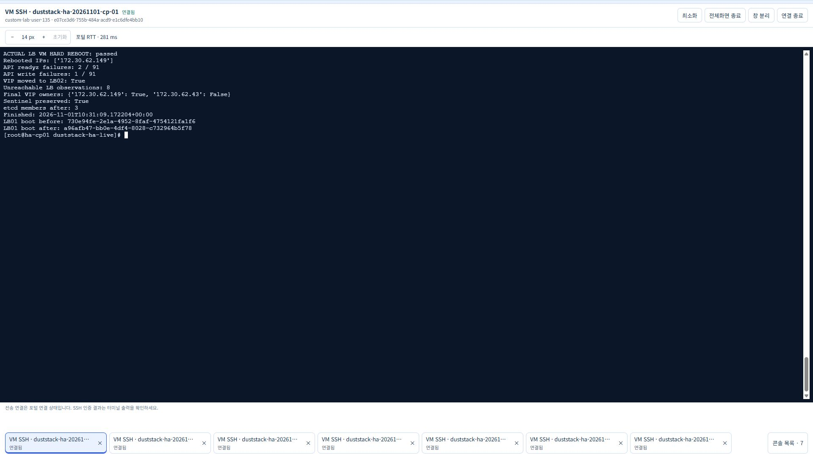
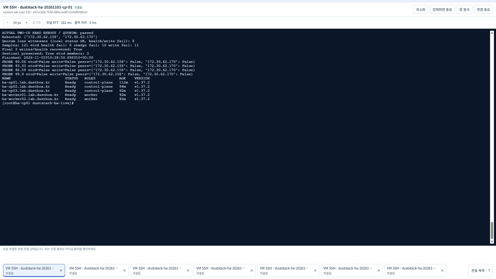
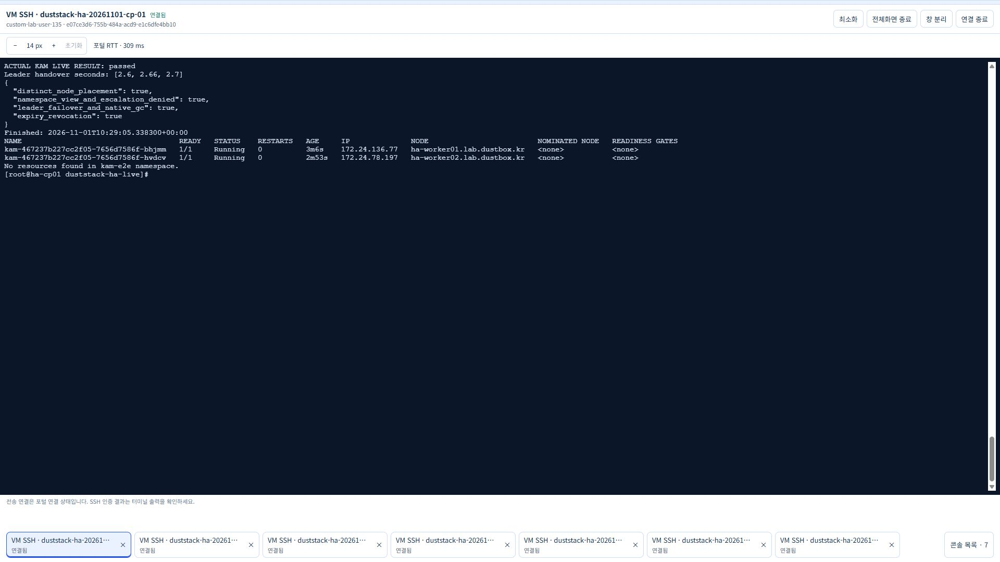

# VM 전원 장애·etcd quorum·KAM 리더 인수 실증

2026-11-01의 기존 전용 HA 랩 `duststack-ha-20261101`에서 수행한 후속 기록입니다.
기존 Kubernetes·Calico·API 주소와 etcd 데이터를 유지하고 KAM controller만 갱신했습니다.
앞선 HAProxy 프로세스 중지·90.37초 리더 교체 기록은 [이전 실증](HA-KAM-LIVE.md)에 보존합니다.

## 장애 주입과 판정 방법

Nova `reboot`의 `HARD` 유형을 사용했습니다. 이는 게스트의 정상 종료를 요청하는
soft reboot와 달리 전원을 끊고 다시 넣는 방식입니다.
[OpenStack 공식 API](https://docs.openstack.org/api-ref/compute/?expanded=reboot-server-reboot-action-detail)를 기준으로 사용했습니다.
물리 호스트 장애나 장기간 전원 차단을 재현한 실험은 아닙니다.
관리 SDK는 이번 프로젝트의 정확한 VM ID·전용망·실행 상태를 확인한 뒤 대상만 재부팅합니다.
CP01은 관리·관찰 노드로 유지합니다. 기존 다른 랩과 공유망 설정은 변경하지 않았습니다.

관찰기는 `scripts/test_live_power.py`입니다. 클라우드 자격 증명을 받거나 VM을 직접 조작하지
않으며, 운영자가 별도로 주입한 장애를 관찰합니다. 전후 boot ID 변경, API `/readyz`,
별도 namespace의 ConfigMap 쓰기, 로컬 etcd의 선형화 health와 status, peer의 TCP 2379,
VIP 소유자를 기록합니다. 장애 전 sentinel 데이터와 etcd 3-member 구성이 복구 후에도
유지되는지 확인합니다. 관찰 주기는 명령 실행 시간에 따라 달라집니다.
접속할 수 없는 LB의 VIP 소유 여부는 `null`로 기록하므로, 그 구간의 중복 VIP 부재를
단정하지 않습니다. 인증서·개인키·토큰과 etcd 스냅샷은 내보내지 않습니다.

## LB VM 전원 장애 결과

2026-11-01 19:29:32 KST에 VIP를 소유한 LB01을 HARD 재부팅했습니다.
boot ID가 바뀌었고 LB02가 VIP를 소유한 상태의 API 성공을 관측했습니다.
주입 요청 8.75초 후 시작한 표본에서 이 복구를 확인했으며, 표본 내 명령 실행 시간이
추가로 포함됩니다. 정밀한 전환 시간이나 무중단 보장이 아닙니다.

총 91표본 중 `/readyz` 실패 2회·API 쓰기 실패 1회였습니다. LB 접근 불가 표본은 8개였고
두 LB를 모두 조회할 수 있는 표본에서는 중복 VIP를 관측하지 않았습니다.
접근 불가 구간까지 중복 VIP가 없었다고 단정하지 않습니다. 재부팅 후 LB01이 다시
VIP를 소유했고, 마지막 API 쓰기·etcd health와 3-member 구성, sentinel 보존이 통과했습니다.
[실제 LB 원문](validation/power-lb-2026-11-01.json)을 참고하세요.



## control plane 한 대 전원 장애 결과

CP02 한 대를 HARD 재부팅한 결과 130표본 모두에서 CP01의 etcd health가 성공했습니다.
CP02의 TCP 2379 접근 불가 19표본 중 17표본에서 API 쓰기가 성공해 남은 2/3 quorum의
동작을 확인했습니다. 전체 `/readyz` 실패는 2회, 2초 요청 제한의 API 쓰기 실패도 2회였으며
무중단이라고 해석하지 않습니다. CP02만 boot ID가 바뀌었고 CP03은 유지됐습니다.
복구 후 두 peer의 TLS API·로컬 etcd health·3-member 구성·sentinel 보존이 통과했습니다.
[실제 단일 CP 원문](validation/power-cp-single-2026-11-01.json)을 참고하세요.

## control plane 두 대·etcd quorum 상실 결과

CP02·CP03의 HARD 재부팅 요청은 2026-11-01 19:36:16 KST에 약 0.012초 차이로
접수됐습니다. CP01은 계속 실행했습니다. 총 121표본 중 양쪽 peer의 TCP 2379 접근이
동시에 불가하고, 로컬 etcd status 조회는 성공하지만 health와 API 쓰기가 실패한
표본은 **8개**였습니다. quorum 상실에 따른 예상 쓰기 중단을 실제로 확인한 결과입니다.
전체 etcd health 실패 8회, `/readyz` 실패 10회,
API 쓰기 실패 11회를 숨기지 않고 보존했습니다.

두 peer의 boot ID가 모두 바뀌었고 자동 재기동 후 쓰기가 복구됐습니다.
마지막 세 표본의 etcd health·API 쓰기, 두 peer의 TLS `/readyz`, 3-member 구성과
기존 sentinel 보존이 모두 통과했습니다. member 제거·재가입·snapshot 복원·reset은
수행하지 않았습니다. 이는 원래 member의 디스크를 보존한 일시적인 quorum 상실/복구이며,
영구적인 과반수 디스크 손실에서의 백업 복원 검증과 구분합니다.
[실제 quorum 원문](validation/power-cp-quorum-2026-11-01.json)과
[관리 API의 장애 주입 응답](validation/power-fault-actions-2026-11-01.json)을 참고하세요.



## KAM 종료 동작 개선

SIGTERM/SIGINT 수신 시 새 조정을 멈추고, 진행 중인 조정이 끝난 후 자신의 Lease만
resourceVersion과 함께 반납합니다. 다른 소유자의 Lease와 충돌하는 오래된 반납은
거부됩니다. 대기 controller는 2초마다 재확인하며 종료 유예는 45초입니다.
rolling update는 `maxSurge: 0`, `maxUnavailable: 1`로 진행합니다.
강제 종료·VM 전원 장애·API 불통으로 반납할 수 없는 경우에는 기존 60초 Lease 만료가
적용됩니다. 정상 Pod 삭제의 개선값을 이런 장애의 인수 시간으로 해석하면 안 됩니다.

로컬 회귀 73개와 실제 API 통합 검사, CLI 공급 검사, 공식 차트 4종 렌더링을 통과했습니다.
SIGTERM 프로세스 검사와 오래된 소유자의 반납 거부, 실제 API에서 반납 직후 다른
리더가 인수하는 검사도 포함합니다. 이는 아래 실제 VM 관측과 구분합니다.

## 실제 KAM 결과

리더 Pod를 순서대로 세 번 삭제했습니다. 각 회차 사이에 replica 2개가 서로 다른 worker에서
Ready로 복원되는 것을 확인했습니다. 인수 시간은 **2.60초, 2.66초, 2.70초**였습니다.
종전 90.37초 관측과 동일한 정상 Pod 삭제 유형의 비교이며 운영 SLO 보장은 아닙니다.
기존 권한은 인수 중 유지됐고 namespace 경계·권한 상승 거부·CR 삭제의 native GC·
75초 만료에 따른 Binding/권한 회수도 통과했습니다.
[실제 원문](validation/kam-fast-live-2026-11-01.json)을 참고하세요.



## 재현 명령

아래는 명령 형식입니다. 실제 대상·키·신뢰한 known_hosts·공식 etcdctl을 본인의
전용 랩에 맞게 지정해야 합니다. 이번 랩은 CP01의 공식 etcd 컨테이너에 포함된
`/proc/<etcd PID>/root/usr/local/bin/etcdctl` 3.7.0을 사용해 추가 바이너리 설치를 피했습니다.
인증키 값은 읽거나 복사하지 않고 호스트의 기존 TLS 파일 경로만 참조했습니다.

```bash
python3 scripts/test_live_kam.py --kubeconfig /etc/kubernetes/admin.conf \
  --namespace kam-e2e --leader-trials 3 --max-handover-seconds 20 \
  --confirm-disposable-lab --output .tools/kam-fast-live.json
python3 scripts/test_live_power.py --kubeconfig /etc/kubernetes/admin.conf \
  --etcdctl /path/to/official/etcdctl \
  --peer 172.30.62.158 --peer 172.30.62.170 \
  --lb 172.30.62.149 --lb 172.30.62.43 \
  --identity-file /path/to/scoped-key --known-hosts /path/to/known_hosts \
  --phase cp-quorum --seconds 180 --confirm-disposable-lab \
  --output .tools/power-cp-quorum.json
```

관찰기의 `POWER_PROBE_READY`를 확인한 뒤 별도 관리 채널로 장애를 주입합니다.
`lb`는 현재 VIP 소유 LB 한 대, `cp-single`은 첫 번째 `--peer` 한 대,
`cp-quorum`은 두 peer를 동시에 HARD 재부팅합니다. 한 단계가 완전히 복구된 후 다음
단계로 진행합니다. etcd member 제거·클러스터 reset·디스크 포맷은 수행하지 않습니다.

## 접근 회수·최종 상태

검증 후 peer 6대의 이번 임시 공개키를 각각 1개씩 제거하고 남은 수가 모두 0개임을
확인했습니다. CP01의 해당 개인키·공개키 파일도 제거했으며 기존 다른 키는 보존했습니다.
테스트 Grant와 `power-e2e-*` namespace는 남아 있지 않습니다. 노드 5대 Ready,
VIP 및 control plane 3대의 TLS `/readyz`, KAM 두 worker의 Ready Pod를 확인했습니다.
실제 ConfigMap의 controller 소스와 VM에서 실행한 런타임 파일 4개를 저장소의
LF 정규화 SHA-256과 모두 대조했습니다.
[접근 회수·런타임 대조 원문](validation/power-cleanup-2026-11-01.json)을 참고하세요.

19:41 KST에 이번 VM 7대가 모두 `SHUTOFF`임을 관리 API로 확인했습니다.
[전원 종료 확인](validation/ha-power-lab-stop-2026-11-01.json)을 보존했습니다.
OS 디스크 총 240 GiB와 전용망·보안그룹은 유지하므로 보관료는 계속 발생합니다.

추가 검증 대상은 물리 장애 영역 분리, 장기간 전원 차단, 영구 과반수 손실의
백업 복원, API watch 재연결과 운영 부하에서의 SLO입니다. 이번 값은 한 랩의 관측이며
무중단·무손실 백업 복구 또는 강제 종료 시 KAM 2초대 인수를 보장하지 않습니다.
