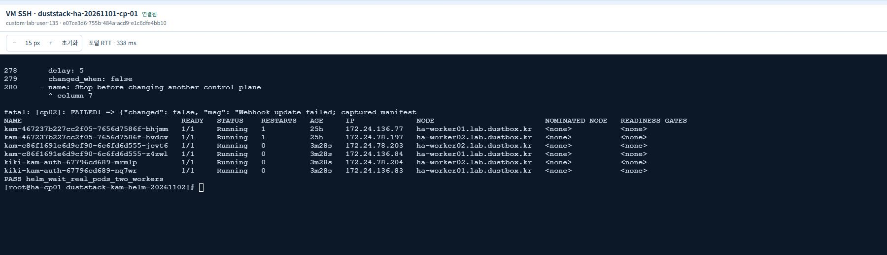
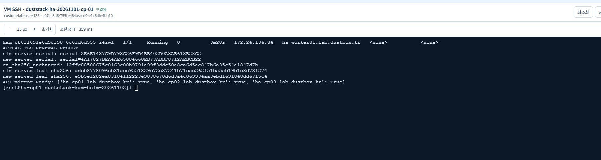
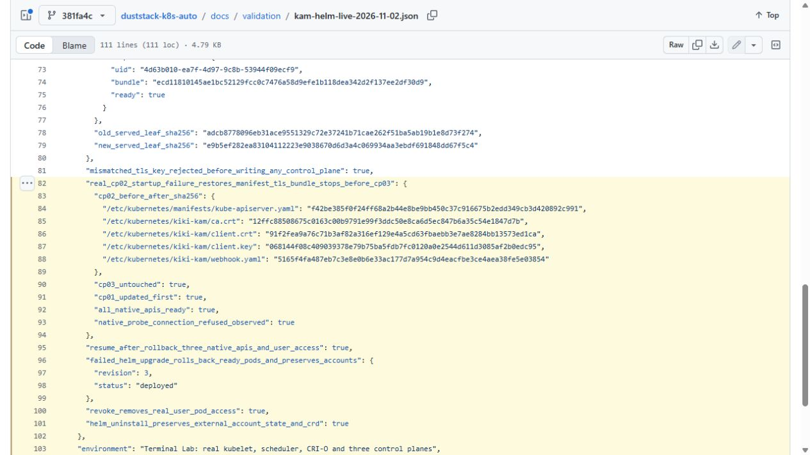

# KAM Helm·TLS 실제 클러스터 실증 — 2026-11-02

터미널랩의 기존 HA 전용 랩에서 **Helm 실제 Pod 배포, ID·비밀번호 로그인/RBAC, 인증서 갱신, 잘못된 키 거부, API 서버 시작 실패 시 bundle 복구, Helm 실패 갱신 복구**를 확인했습니다. 결과는 [실증 원문](validation/kam-helm-live-2026-11-02.json)과 [정리·VM 중지 원문](validation/kam-helm-cleanup-2026-11-02.json)에 저장했습니다. 화면은 실제 터미널과 게시한 실증 원문 열람 화면이며, 예상 출력 예시는 별도 코드 블록으로 구분합니다.

## 실행 환경

| 항목 | 실제 값 |
| --- | --- |
| 실행 시간 | 2026-11-02 20:28:26 KST ~ 2026-11-02 20:52:43 KST |
| duststack 실증 코드 | `d6ef7e1046c9f540f121f7566a40294060f1719a` |
| KAM 실행 소스 | `07f4f03ef2f0005abd995fc415efeb61f2e6662e` |
| Helm | `v4.3.1+gc0d08d0` · 로컬 소스 차트 0.1.0 |
| 클러스터 | Kubernetes/CRI-O 1.37.2 · Rocky Linux 9 계열 |
| 구성 | control plane 3대·worker 2대·Keepalived+HAProxy LB 2대 |
| 기존 네트워크 | Calico · Pod 172.24.0.0/16 · Service 172.25.0.0/16 · API VIP 172.30.62.250 |
| 설치 대상 | `kam-system` · 테스트 namespace `kam-helm-e2e` |
| 이미지 공급 | 고정 소스로 랩에서 빌드한 `localhost/kiki-kam-auth:lab`를 두 worker의 CRI-O 저장소에 공급 · `Never` pull |

최종 고정 KAM은 `860a6b0d6fdc0d2e67725268646fa50970e4c255`입니다. 실증한 `07f4f03` 이후 README·문서만 갱신했으며, 실행 코드·차트·manifest·빌드·테스트를 포함한 문서 외 62개 파일의 Git blob bytes와 SHA-256이 동일함을 [비교 원문](validation/kam-source-equivalence-2026-11-02.json)에 기록했습니다. `config/kam-source.json`에는 새 commit의 아카이브·전체 파일 SHA-256을 고정했습니다. 운영용 인증 이미지는 검토한 registry의 실제 digest를 사용해야 합니다. 테스트용 로컬 태그 허용은 명시적 선택입니다.

## 확인한 동작

| 검사 | 실제 결과 |
| --- | --- |
| Helm `install --wait` | auth 2개·controller 2개 모두 Ready, 각각 서로 다른 worker에 배치 |
| 최초 webhook 적용 | CP01 → CP02 → CP03 순차 적용, 새 mirror UID·bundle annotation·Ready 확인 |
| 사용자 로그인·RBAC | 실제 비밀번호 로그인·Pod 조회 허용·Secret 조회 Forbidden, impersonation 미사용 |
| 같은 CA의 leaf 갱신 | server/client leaf 변경, 실제 NodePort 제공 인증서 변경, auth·API Pod 재시작 뒤 사용자 조회 성공 |
| 잘못된 client key | preflight 거부, CP 3대의 manifest·TLS/config 파일 SHA-256 모두 그대로 유지 |
| 갱신 중 CP02 API 시작 실패 | 임시 실증 playbook만 잘못된 옵션을 주입, CP02 manifest·CA·client cert/key·webhook을 원래 bytes로 복구 |
| 순차 실패 경계 | CP01은 새 bundle 유지, CP02는 이전 bundle 복구, CP03은 변경하지 않음 |
| 복구 후 재실행 | 원본 playbook으로 세 API 정상 및 사용자 접근 확인 |
| Helm 실패 갱신 | 없는 로컬 이미지로 실패 유도, `--rollback-on-failure`로 정상 이미지·Ready Pod 복구, 계정 Secret data 보존 |
| 권한 회수 | 실제 사용자 Pod 조회가 Forbidden으로 바뀌고 native API는 정상임을 확인 |
| Helm uninstall | 외부 계정 Secret data·CRD 보존을 확인한 뒤 테스트 전용 데이터만 별도 정리 |

TLS 서버 leaf의 실제 연결 관측값은 다음과 같습니다. 인증서는 전용 CA로 검증하며 TLS 검증을 끄지 않았습니다.

```text
기존 서버 serial: serial=2E6E1437C9D793C26F9D4BB402D0A3AB613B28C2
갱신 서버 serial: serial=4A17027DEA4AE65084660ED73ADDF8712AEBCB22
기존 제공 leaf SHA-256: adcb8778096eb31ace9551329c72e37241b71cae262f51ba5ab19b1e8d73f274
갱신 제공 leaf SHA-256: e9b5ef282ea83104112223e9038670d6d3a4c069934aa3ebdf691848dd67f5c4
동일 CA SHA-256: 12ffc88508675c0163c00b9791e99f3ddc50e8ca6d5ec847b6a35c54e1847d7b
```



상단에는 직전 장애 주입의 복구 메시지가 남아 있습니다. 그 아래 Pod 행은 최종 실증의 배포 완료 시점 `kubectl get pods` 조회이며, 신규 Pod 이름은 실증 원문과 일치합니다.





17번은 GitHub에 게시한 실제 복구 원문 열람 화면입니다. 테스트가 끝난 뒤 VM은 중지했습니다.

## 재현과 설치

일반 설치는 [KAM 로컬 설치 안내](https://github.com/tangt64/KAM/blob/main/docs/LOCAL-INSTALL.md)의 외부 Secret 최초 생성·bootstrap·소스 차트 적용 순서를 따릅니다. Helm은 애플리케이션 리소스를 관리하고, `bash setup-k8s.sh kam-webhook ...`은 API 서버 연결만 관리합니다. 같은 리소스에 Helm과 `kam-auth`를 섞지 않습니다.

실증 도구는 [scripts/test_live_kam_helm.py](../scripts/test_live_kam_helm.py)입니다. **운영 클러스터에서 실행하면 안 됩니다.** CP02 API 서버에 실제 잘못된 옵션을 넣습니다. 보호 namespace에 기존 인증 서비스·계정 Secret·Helm release가 있으면 인수를 거부하며 테스트 namespace·계정은 새로 생성합니다. inventory에는 `cp01`(local), `cp02`, `cp03`만 두고 `ansible_host`, 기존 `k8s_ip4`, `nodename`, 만료되는 제한된 SSH 키와 검증한 known-hosts를 명시합니다. controller/대상 노드의 Ansible Python 실행 환경, 두 worker의 CRI 이미지와 CLI를 먼저 준비해야 합니다.

아래는 **재현용 명령 예시**이며 파일 경로·접속 주소는 해당 전용 랩 값으로 바꿉니다.

```bash
kam_source="$(python scripts/prepare_kam_source.py)"
python scripts/test_live_kam_helm.py --confirm-disposable-lab \
  --kubeconfig /etc/kubernetes/admin.conf --kam-source "$kam_source" \
  --kam-binary /private/kubectl-kam --helm /private/helm \
  --inventory /private/reviewed-three-cp.json --tls-dir "$PWD/.tools/lab-pki" \
  --auth-url https://PRIVATE_CP01:30443 --auth-image localhost/kiki-kam-auth:lab \
  --output "$PWD/.tools/lab-result.json"
```

복구 경계는 노드별 API manifest·client mTLS bundle입니다. 서버 TLS Secret은 Helm 외부 자원으로 별도 운영 절차로 관리하며, 이번에는 같은 CA의 정상 server leaf 갱신과 실제 제공 인증서를 확인했습니다. CP02 실패 때 이미 성공한 CP01은 새 bundle을 유지하며, 같은 CA의 기존·신규 leaf가 함께 유효하므로 원본 playbook으로 나머지 노드를 재시도할 수 있습니다. CA 교체·endpoint 이동에는 별도 migration이 필요합니다. 실증의 API 재시작 구간에서 별도 조회의 일시적 EOF/timeout이 관측됐습니다. 기존 장기 watch·TCP 세션의 무중단 유지는 이번 측정 범위가 아닙니다.

## 발견한 문제와 정리

- `kam-webhook` 도움말만 있고 실행 분기가 없던 문제를 고치고 실제 shell의 인자·오류 전파 회귀를 추가했습니다.
- GitHub Ubuntu의 multi-call coreutils가 복사된 바이너리 이름을 읽어 실패한 회귀는 실제 실행 중인 shell inode를 검사하도록 수정했습니다.
- Helm 4에서 제거된 `list -a`를 실증 도구에서 제거했습니다.
- 첫 랩 실행에서 CP02·CP03의 명시한 Python 3.12가 없었으나 사전 검사에서 멈추고 native 설정과 테스트 리소스를 정리했습니다. 실행 환경을 준비한 뒤 전체 실증을 다시 수행했습니다.
- Ansible 2.21의 오류 분리 출력에서 rollback 메시지가 stderr에 기록돼 실증 도구가 중단된 문제를 고쳤습니다. 두 출력 채널을 검사하며 일반 오류나 성공 반환을 복구 성공으로 인정하지 않는 회귀를 추가했습니다. 수정한 도구로 전체 절차를 다시 통과했습니다.

최종 실증은 테스트 전 native API manifest와 전용 bundle 파일 상태를 정확히 복원했습니다. 테스트 release·namespace·계정/TLS Secret·CA ConfigMap·테스트 Lease와 임시 인증서를 정리했습니다. Helm uninstall의 계정 보존 확인과 명시적 테스트 데이터 정리는 별도 동작입니다. 기존 controller·CRD·다른 namespace·CNI/CIDR/API VIP는 보존했습니다. 임시 SSH 키는 CP02·CP03·worker 2대에서 제거했고 CP01의 key pair도 제거했습니다. 전용 VM 7대는 SHUTOFF이며 디스크·네트워크는 보관합니다.

## 코드·CI 검증

로컬 `bash scripts/validate.sh`는 85개 회귀와 실제 controller API·CLI 설치·공식 차트 4개·고정 KAM 차트를 통과했습니다. 독립 KAM의 Go race 검사·실제 API 로그인/RBAC·Helm lifecycle 13개 검사·5개 차트 구성 및 잘못된 설정 거부도 통과했습니다. 이는 위 실제 Pod/VM 검사와 별도로 수행했습니다.

실증 코드 CI: [duststack GitHub](https://github.com/tangt64/duststack-k8s-auto/actions/runs/41437089245), [duststack Gitea](https://git.vlab.dustbox.kr/dustbox/duststack-k8s-auto/actions/runs/17), [KAM GitHub](https://github.com/tangt64/KAM/actions/runs/41431033206), [KAM Gitea](https://git.vlab.dustbox.kr/dustbox/kiki-kam/actions/runs/4). 문서·고정 버전 갱신 후 최신 commit의 Actions도 별도로 확인합니다.
