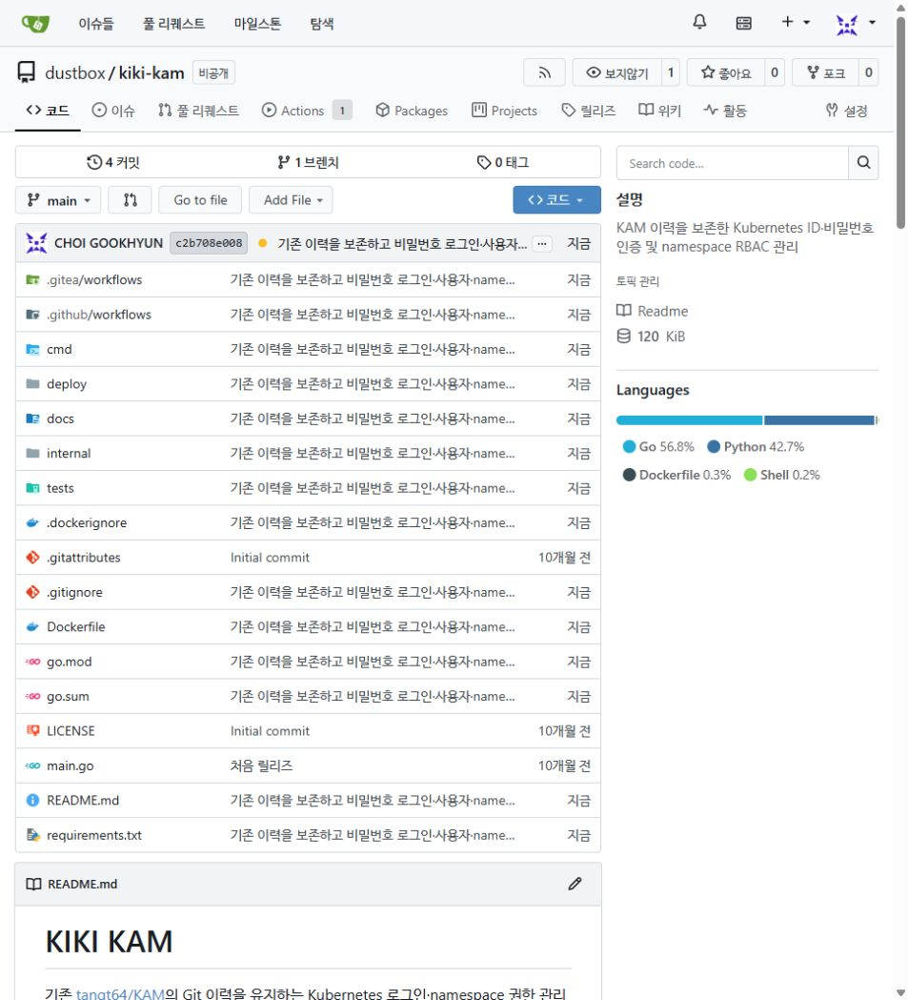
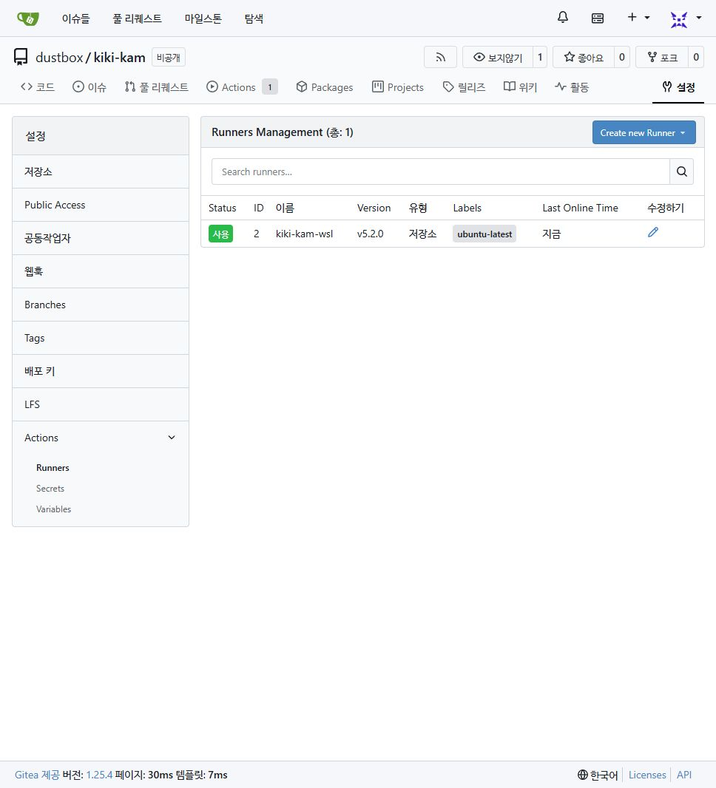

# KIKI KAM 로그인과 duststack 설치 연동

KAM은 기존 Git 이력을 유지한 [GitHub KAM](https://github.com/tangt64/KAM) / [Gitea kiki-kam](https://git.vlab.dustbox.kr/dustbox/kiki-kam)으로 분리했습니다. duststack은 `config/kam-source.json`의 commit·archive SHA-256·파일별 SHA-256으로 소스를 가져옵니다. 실행 바이너리·차트 아카이브는 저장소에 넣지 않습니다.

## 소스 준비

```bash
python scripts/prepare_kam_source.py
```

오프라인은 동일 commit의 GitHub codeload tar.gz를 `artifacts/kiki-kam-<commit>.tar.gz`에 배치하세요. 같은 SHA 검증을 적용합니다. 개발 중에만 `KAM_SOURCE_DIR`로 별도 checkout을 지정할 수 있으며 배포에서는 고정 다운로드/수동 아카이브를 사용합니다. 기존 `addons/kam/` 경로는 이 검증된 소스를 실행하는 호환 진입점입니다. 해당 파일만 PATH로 복사하지 마세요. CRD API group과 기존 Grant는 유지합니다.

## 사전 준비

- 기존 kubeadm 클러스터·인벤토리와 native 관리자 자격을 사용합니다. control plane은 `k8s_master`, 노드별 `k8s_ip4`가 필요합니다.
- 스케줄 가능한 노드 2대와 관리자 전용 `kam-system`, 대상 namespace(예: `dev`)를 먼저 준비합니다.
- 컨트롤러 환경에 Go 1.26.10을 다운로드할 수 있는 Go, Python 3.12+, PyYAML, Ansible, OpenSSL을 준비합니다.
- KAM Dockerfile을 빌드해 승인된 레지스트리에 push하고 **실제 manifest digest**를 기록합니다. 공개 공식 auth 이미지는 아직 없습니다. private registry라면 노드의 승인된 pull 인증을 먼저 구성하세요.
- 모든 control plane과 사용자에서 도달하는 HTTPS endpoint를 준비합니다. 기본 ClusterIP 또는 명시적 private NodePort를 사용할 수 있습니다. 프록시는 `/authenticate`의 전용 mTLS를 보존해야 합니다. TLS를 종료하며 인증서를 버리는 일반 프록시는 사용할 수 없습니다.

```bash
python scripts/prepare_kam_source.py
python scripts/kam_tls.py --out artifacts/kam-pki --hostname kam.example.internal
```

별도 KAM CA를 생성하며 leaf는 90일 만료입니다. `--renew` 후 같은 설치를 다시 실행하면 leaf를 갱신합니다. CA 키는 대상 노드에 복사하지 않으며 안전하게 별도 보관합니다. 클러스터 CA 재사용은 거부합니다.

최초 관리자 비밀번호는 12~72 UTF-8 바이트이고 기본값이 없습니다. 저장소 밖에 0600 파일로 준비하고 인벤토리·Git·로그에는 넣지 마세요. 아래 YAML은 **설정 예시**입니다. 도메인·경로·digest는 실제 값으로 대체합니다.

```yaml
# inventory/local-lab/kam-auth.yaml (개인 설정; Git 제외)
kam_confirm_admin: true
kam_namespace: dev
kam_auth_image: registry.example.internal/kiki-kam-auth@sha256:실제64자리해시
kam_auth_url: https://kam.example.internal
kam_auth_tls_dir: /private/kam-pki
kam_auth_bootstrap_username: admin
kam_auth_bootstrap_password_file: /private/first-password.txt
# private NodePort가 필요한 경우에만 명시; 기본값은 ClusterIP
# kam_auth_node_port: 30443
```

```bash
bash setup-k8s.sh kam-auth -i inventory/local-lab/hosts.yaml \
  -e @inventory/local-lab/kam-auth.yaml
```

계정 Secret은 최초에만 `create`하고 재설치 시 보존합니다. 첫 control plane에서 CLI를 빌드·설치하고 auth Deployment 두 replica의 rollout을 검사합니다. 기존 API audience를 그대로 사용하며 dedicated mTLS probe가 성공한 다음 control plane을 **serial: 1**로 변경합니다. 원본 manifest는 kubelet 감시 디렉터리 밖에 보관합니다. 새 listener 기동 후 native 인증서의 `/readyz`와 권한을 확인하며 실패하면 해당 노드의 원본 manifest를 복구하고 다음 노드로 진행하지 않습니다. 기존 인증서·ServiceAccount·API 주소·CNI/CIDR는 변경하지 않습니다.

위 playbook은 API 서버를 재시작하므로 관리 시간에 적용하세요. 설치 중 auth URL·DNS·TLS·이미지 pull 경로가 실패하면 해결한 뒤 재실행합니다. auth 인증 장애 시 native 관리자 인증을 비상 경로로 유지합니다. `--check`는 설치·인증 성공을 입증하지 않습니다.

## 사용자 CLI

KAM checkout에서 Go CLI를 빌드해 사용자 PATH의 `kubectl-kam`으로 설치합니다. [KAM README](https://github.com/tangt64/KAM#readme)에 전체 명령·운영 한계를 설명했습니다.

```bash
kubectl kam login https://kam.example.internal --username admin \
  --server https://api.example.internal:6443 --ca-file kam-ca.crt --api-ca-file cluster-ca.crt
kubectl kam user create alice
kubectl kam grant alice -n dev --profile view
kubectl kam namespace list
kubectl kam namespace use dev
kubectl kam user disable alice
kubectl kam user enable alice
kubectl kam user delete alice
kubectl kam logout
```

비밀번호는 숨김 프롬프트입니다. 일반 사용자는 자신의 login·passwd·whoami·permissions·logout을 사용합니다. 계정 생성/초기화와 namespace RBAC 위임을 분리하며 account-admin은 cluster-admin이 아닙니다. namespace 생성·삭제는 기존 관리자에게 남깁니다. `view` 기본값을 넘는 프로필은 namespace controller 설치 시 명시적으로 허용해야 합니다.

CRD에는 비밀번호나 세션을 저장하지 않습니다. 불변 사용자 UID를 사용하므로 같은 ID를 삭제·재생성해도 옛 Binding을 인수하지 않습니다. disable/delete CLI는 먼저 인증을 차단하고 해당 UID의 Grant를 정리하며 정리 실패는 오류로 알립니다. OIDC는 향후 provider와 `(issuer, sub)` 명시적 연결을 추가할 수 있도록 구조만 준비했으며 현재 제공되는 로그인은 ID·비밀번호입니다.

## 검증 범위와 제한

이번에는 WSL의 실제 Kubernetes 1.37.0 API·etcd와 두 auth 프로세스에서 실제 자격으로 로그인·조회·권한 상승 거부·만료·회수를 검사했습니다. impersonation을 사용하지 않았습니다. 비밀번호 변경·로그아웃·비활성화 후 거부까지 약 10초였으며 API 서버의 성공 인증 캐시가 영향을 줍니다. webhook TTL을 낮춰도 즉시 차단을 보장하지 않고 이미 열린 watch 연결의 강제 종료는 구현하지 않았습니다.

이 검증은 Pod scheduling, image pull, 새 auth playbook의 다중 VM 적용, 인증 서비스 Pod 장애 전환을 입증하지 않습니다. 이전 [HA 실증](HA-POWER-LIVE.md)은 기존 controller/HA 기능의 별도 결과입니다. 중지된 유료 랩은 이번 작업에서 재개하지 않았습니다.

실제 저장소 생성·이력 보존 화면입니다. 노란 CI 표시는 runner 대기 상태이며 성공 화면이 아닙니다.



최종 로컬 전체 검증은 `RUN_CLI_INTEGRATION=1 RUN_CHART_VALIDATION=1 RUN_KAM_API_INTEGRATION=1 bash scripts/validate.sh`로 실행했습니다. 회귀 **77개 전부 통과**(kubeadm 스키마 포함), 실제 API/CLI 통합과 공식 차트 4개 렌더링을 확인했습니다. 인증 컨테이너도 rootless Podman에서 빌드하고 비루트 `kam version 0.2.0` 실행을 확인했습니다. registry push·실제 Pod rollout은 이 결과에 포함하지 않습니다.

## 저장소 전용 Gitea runner

사용자 승인 후 현재 PC의 WSL `tang` 사용자에 공식 runner 5.2.0 `kiki-kam-wsl`을 저장소 범위로 등록했습니다. 상태·등록 파일·로그는 `~/.local/share/kiki-kam-gitea-runner/`(0700, 등록/설정 파일 0600)에 있으며 기존 duststack runner와 분리했습니다. 등록 토큰 임시 파일은 사용 후 제거했습니다.

rootless Podman의 별도 socket과 `kiki-kam-runner-ci` bridge를 사용합니다. WSL user bus가 없어 내부 서비스 DNS 초기화가 실패한 문제는, 서비스 컨테이너 이름 해석을 사용하지 않는 이 workflow에 전용 DNS 비활성 bridge를 지정해 해결했습니다. host 네트워크·privileged·작업 컨테이너의 호스트 socket mount는 사용하지 않습니다. 워크플로에는 외부 DNS와 HTTPS 다운로드가 필요합니다. service container DNS를 사용하는 workflow를 추가하려면 네트워크 구성을 다시 검토하세요.

runner는 이 PC·WSL이 실행 중이어야 동작합니다. 재부팅 후 자동 시작 서비스는 등록하지 않았습니다. 재개할 때 공식 runner 바이너리의 SHA-256을 다시 확인한 후, 동일 사용자의 Podman 서비스(`--cgroup-manager=cgroupfs`, 전용 socket)와 `daemon --config ~/.local/share/kiki-kam-gitea-runner/config.yaml`을 사용합니다. 기존 PID와 socket이 살아 있는 경우 중복 실행하지 마세요. `.runner` 내용을 출력·공유하거나 저장소에 넣지 않습니다.

실제 API 11개 조건의 최신 원문은 [KAM 검증 기록](https://github.com/tangt64/KAM/blob/e383003ded4a6a0d914b187d86e5cac62241d384/docs/auth-api-result.json)에 보관했습니다. 비밀번호 초기화 9.243초·로그아웃 10.140초·비활성화 10.349초 후 실제 API가 기존 토큰을 거부했고, 명시적 context 변경 시 다른 current-context를 보존했습니다.

[Gitea KAM 최종 커밋 CI](https://git.vlab.dustbox.kr/dustbox/kiki-kam/actions/runs/3)와 [GitHub KAM Actions](https://github.com/tangt64/KAM/actions), [duststack Gitea](https://git.vlab.dustbox.kr/dustbox/duststack-k8s-auto/actions)·[GitHub Actions](https://github.com/tangt64/duststack-k8s-auto/actions)에서 각 커밋의 서버 검증 결과를 확인할 수 있습니다.

아래는 kiki-kam 최종 기능 커밋 e383003의 Gitea Actions 전체 성공을 촬영한 실제 화면입니다. 전용 runner에서 Go race·controller 실제 API·비밀번호 실제 API 11개 검사가 모두 통과했습니다.



### 양쪽 서버의 기능 검증 완료

2026-11-01 최종 기능 변경의 CI 네 개가 모두 통과했습니다. 이 기록 뒤의 화면·문서만 변경하는 커밋은 같은 workflow로 다시 검사합니다.

| 대상 | 기능 검증 커밋 | GitHub | Gitea |
| --- | --- | --- | --- |
| KAM | e383003ded4a6a0d914b187d86e5cac62241d384 | [성공](https://github.com/tangt64/KAM/actions/runs/41310949683) | [성공](https://git.vlab.dustbox.kr/dustbox/kiki-kam/actions/runs/3) |
| duststack | 5c76072fb8b468fcc56cc2834287e5352d5de19f | [성공](https://github.com/tangt64/duststack-k8s-auto/actions/runs/41311070791) | [성공](https://git.vlab.dustbox.kr/dustbox/duststack-k8s-auto/actions/runs/8) |

## 2026-11-02 로컬 YAML·Helm 추가

새 로컬 패키지와 webhook 전용 설치, 플레이북 검토 내용은 [로컬 설치·검토 기록](KAM-LOCAL-REVIEW.md)에 정리했습니다. 이번 작업본은 아직 커밋·푸시되지 않았으며 기존 고정 소스는 유지합니다.
