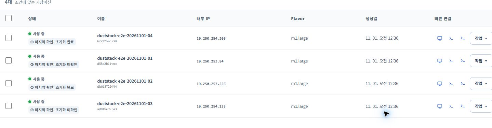
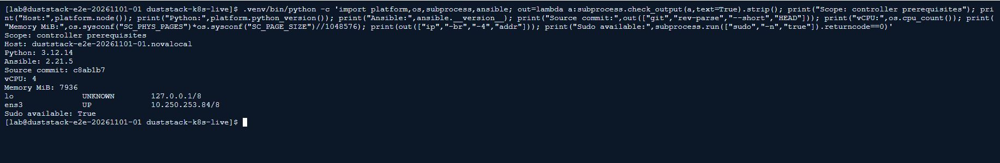

# 터미널랩 사용 방법과 실행 화면

기록일: 2026-11-01. **실제 촬영 화면**과 **예상 출력 예시**를 구분합니다.
VM 실행, 소스 검사, 실제 Kubernetes/CNI/CSI 검증은 각각 다른 완료 단계입니다.

## 1. 전용 VM과 디스크 준비

Rocky Linux 9 계열 VM 4대를 준비합니다. 각 VM은 4 vCPU, 8 GiB RAM,
OS 40 GiB이며 worker 3대에는 각각 빈 50 GiB 블록 볼륨을 추가합니다.
control plane의 전용 실습 디렉터리를 NFS backend로 사용할 수 있습니다.
CPU/RAM/볼륨 잔여 쿼터, 실행·보관 디스크·트래픽 요금을 먼저 확인하세요.

**실제 촬영: 생성된 VM 4대의 포털 상태입니다.** 이 화면의 ‘사용 중’은 VM 실행
상태이며 Kubernetes Node Ready나 Cilium·PVC 검사 통과를 의미하지 않습니다.
초기화 자동 확인의 마지막 결과도 SSH 실접속 결과와 구분합니다.



전용망을 연결하고 VM 내부에서 실제 주소·NIC·MTU를 확인합니다.

```bash
ip -br -4 address
ip route
lsblk -o NAME,TYPE,SIZE,FSTYPE,MOUNTPOINTS
```

포털의 볼륨 이름이나 ‘부팅 가능’ 표시만으로 빈 디스크를 판단하지 않습니다.
연결 전후 장치 목록과 볼륨 식별자를 대조하세요. Rook 설치 전에는 플레이북이
마운트·파티션·파일시스템·서명·최소 크기를 읽기 전용으로 다시 검사합니다.
기존 교육용 VM, OS 디스크, 다른 클러스터의 NIC와 보안그룹은 사용하지 않습니다.

## 2. control plane의 실행 환경 준비

VM 목록의 해당 호스트 **xterm**을 열고 SSH 연결을 확인합니다. 다음 명령은 새
전용 control plane에서 실행합니다. 비밀번호·토큰·kubeconfig 내용은 촬영하지 않습니다.

```bash
sudo dnf -y install python3.12 python3.12-pip git
git clone --depth 1 https://github.com/tangt64/duststack-k8s-auto.git duststack-k8s-live
cd duststack-k8s-live
bash setup-k8s.sh deps
```

설치된 버전과 실행 위치를 확인합니다.

```bash
python3.12 --version
.venv/bin/ansible --version
git rev-parse --short HEAD
```

**실제 촬영: control plane의 준비 검사 결과입니다.** Python 3.12.14, Ansible 2.21.5,
4 vCPU, 메모리 7936 MiB, sudo 사용과 소스 커밋 `c8ab1b7`을 확인했습니다.
촬영 당시 전용 NIC 연결과 실제 Kubernetes 설치는 아직 완료되지 않았습니다.



## 3. 비공개 인벤토리와 CNI·CSI 설정

[간편 설정 안내](SETUP.md)의 생성기로 실제 SSH 주소·내부 IP·NIC를 지정하고 Cilium을
선택합니다. Cilium 프로필은 Kubernetes 1.36.6/CRI-O 1.36.7 조합입니다.
`inventory/local-live/hosts.yaml`처럼 Git에서 제외되는 경로를 사용하세요.

다음은 **생성된 전체 인벤토리에 합칠 변수 예시**입니다. 주소는 실제 할당값으로
바꾸고, 연결 대역·VPN·기존 클러스터와 Pod/Service CIDR가 겹치지 않는지 확인합니다.
관리 NIC가 `10.0.0.0/8`인 실습 환경에서는 기본 10번대 클러스터 CIDR도 재검토해야 합니다.

```yaml
k8s_pod_cidr: 172.22.0.0/16
k8s_cluster_svc_ip: 172.23.0.0/16
k8s_csi_providers: [nfs, rook]
k8s_default_storage_class: nfs-csi
nfs_server: 172.30.61.11  # 예시: 실제 NFS backend 주소로 변경
nfs_share: /srv/duststack-e2e
terminal_lab_nfs_root: /srv/duststack-e2e
terminal_lab_confirm_dedicated: false
rook_confirm_devices: false
```

NFS 호스트를 `k8s_lab_nfs`에, worker 3대를 `k8s_storage_ceph`에 등록합니다.
각 worker의 `rook_devices`에는 확인한 빈 장치 basename을 지정하세요.
전용 랩과 디스크 사용을 검토한 뒤에만 위 두 확인 변수를 true로 바꿉니다.
[변수 예제](../examples/terminal-lab-live.yaml)와 [CNI·CSI 안내](CNI-CSI.md)를 함께 확인하세요.
SSH 인증정보는 키 또는 Vault 등으로 별도 관리하고 문서·스크린샷·Git에 넣지 않습니다.

## 4. 소스·문법·공급 경로 검증

```bash
bash scripts/terminal-lab-check.sh
```

이 명령은 소스 정책·Markdown 링크·Ansible 문법·회귀 테스트, CLI 다운로드/수동 배치,
공식 Helm 차트 lint/render를 검사합니다. Kubernetes나 CSI 리소스를 설치하지 않습니다.
실제 kubeadm 바이너리가 없으면 추가 스키마 검사만 생략될 수 있습니다.

**예상 출력 예시 — 실제 실행 결과가 아닙니다.**

```text
OK (skipped=1)
CLI integration passed: ...
Chart verified: cilium 1.20.4 25 rendered resources
Chart verified: nfs 4.13.6 9 rendered resources
Chart verified: rook 1.21.1 88 rendered resources
TERMINAL_LAB_VALIDATION=PASS
```

이 단계의 PASS는 실제 Pod 통신이나 PVC 입출력 통과 표시가 아닙니다.
결과 커밋과 검사 범위는 `.tools/terminal-lab-validation.json`에 기록됩니다.

## 5. NFS backend와 신규 클러스터 설치

```bash
ansible-playbook -i inventory/local-live/hosts.yaml playbooks/terminal-lab-nfs.yaml
bash setup-k8s.sh plan -i inventory/local-live/hosts.yaml
bash setup-k8s.sh install -i inventory/local-live/hosts.yaml
```

`plan`은 변경 예상 확인입니다. 신규 설치 성공을 보장하지 않습니다.
호스트 방화벽과 보안그룹에서 전용 노드 사이의 API·VXLAN·NFS 및 필요한 관리 통신을
허용하고, SELinux·호스트 키 확인을 유지한 상태로 실제 설치 결과를 점검하세요.

```bash
sudo kubectl --kubeconfig=/etc/kubernetes/admin.conf get nodes -o wide
sudo kubectl --kubeconfig=/etc/kubernetes/admin.conf -n kube-system get ds cilium
sudo kubectl --kubeconfig=/etc/kubernetes/admin.conf get storageclasses
sudo kubectl --kubeconfig=/etc/kubernetes/admin.conf -n rook-ceph get cephcluster
```

모든 인벤토리 노드 Ready, Cilium agent Ready, Ceph Ready/HEALTH_OK와 복제 3을
확인해야 합니다. 리소스 이름만 존재하는 상태는 설치 완료로 기록하지 않습니다.

## 6. 실제 Cilium 통신과 두 CSI 입출력

admin.conf를 사용할 수 있는 control plane에서 실행합니다.

```bash
sudo python3.12 scripts/test_live_cluster.py --confirm-test-workloads
```

이 명령은 새 `duststack-e2e-*` namespace에 비루트 테스트 Pod와 PVC를 만듭니다.
다른 worker 간 HTTP·서비스/DNS·NetworkPolicy 차단/허용, NFS RWX 공유 쓰기,
4 MiB 체크섬, NFS와 RBD의 교차 노드 재연결 후 읽기·쓰기를 확인합니다.

**예상 출력 예시 — 아래 항목의 실제 통과 화면은 실증 후 추가합니다.**

```text
PASS cilium-agents-ready ...
PASS cilium-cross-node-pod-http ...
PASS clusterip-and-coredns ...
PASS cilium-networkpolicy-deny ...
PASS cilium-networkpolicy-allow ...
PASS nfs-pvc-write ...
PASS nfs-rwx-cross-node-read-write ...
PASS nfs-pvc-cross-node-reattach-io ...
PASS ceph-health-and-replication ...
PASS rook-pvc-write ...
PASS rook-pvc-cross-node-reattach-io ...
LIVE_CLUSTER_VALIDATION=PASS
```

`--providers nfs`처럼 일부 CSI만 실행하면 `PARTIAL_PASS`/`partial_passed`로 기록합니다.
전체 완료 판정은 NFS와 Rook을 모두 검증한 실행의 JSON과 실제 결과로 확인하세요.

## 7. 결과 기록과 종료

`.tools/duststack-e2e-*.json`에서 소스 커밋, 검사 범위, 완료 provider, PVC/PV, 노드와
체크별 결과를 확인합니다. 실패하면 해당 namespace의 Pod/PVC/event 진단도 확인하세요.
실제 촬영과 상태는 [검토 기록](REVIEW.md)에, 이미지별 출처는
[스크린샷 기록](screenshots/README.md)에 정리합니다.

테스트 namespace·PVC·데이터는 자동 삭제하지 않습니다. Retain 데이터의 소유자와
보존 필요성을 확인한 뒤 이번 랩에서 만든 자원만 정리하세요. VM 중지나 볼륨 분리만으로
디스크 보관 요금이 없어지지는 않습니다. 승인한 시간·비용 한도 전에 종료 상태를 확인합니다.
